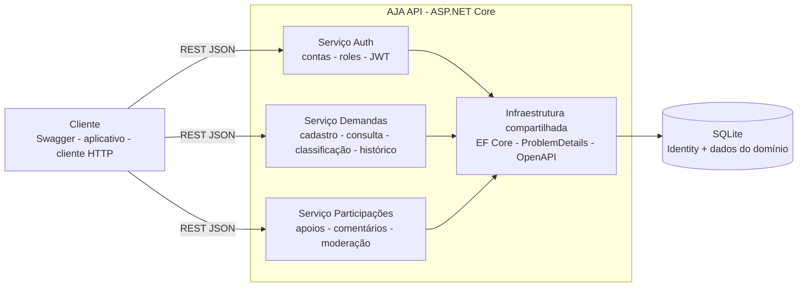
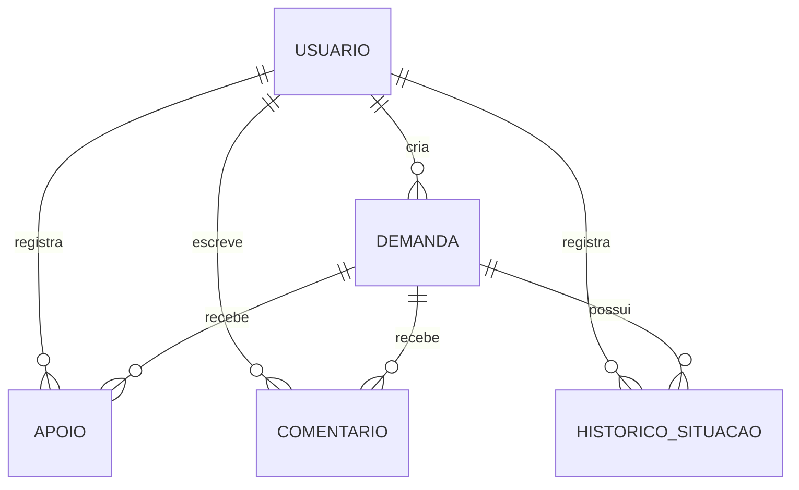

# AJA - Arquitetura Orientada a Serviços e Web Services

Backend orientado a serviços para participação cidadã no registro e acompanhamento de barreiras de acessibilidade urbana. O AJA disponibiliza uma API REST versionada para autenticação, gestão de demandas e participação comunitária, com persistência relacional, documentação automática e testes automatizados.

## Ficha da CitizenTech

| Campo | Definição |
|---|---|
| Nome da CitizenTech | **AJA - Acessibilidade, Justiça e Ação** |
| Cidade e bairro | São Paulo - piloto acadêmico no bairro Doroteia |
| Cidadão beneficiado | Pessoas com deficiência, idosos, acompanhantes, responsáveis por crianças e demais cidadãos afetados por barreiras no espaço urbano |
| Problema, em uma frase | Barreiras em calçadas e espaços públicos dificultam a mobilidade e nem sempre possuem um canal simples, transparente e comunitário para registro e acompanhamento |
| Como funciona | Uma pessoa cria uma demanda com descrição e local; a comunidade apoia e comenta; um administrador classifica a barreira e atualiza a situação com justificativa e histórico automático |
| Parte desenvolvida | Camada de backend formada pelos serviços de autenticação, demandas e participações, expostos por API REST e integrados ao banco SQLite |
| Link do repositório | O próprio repositório GitHub enviado na tarefa de Arquitetura Orientada a Serviços e Web Services |
| Indicadores de impacto | Quantidade de demandas registradas, apoios e comentários; percentual de demandas em andamento ou concluídas; tempo entre abertura e atualização de situação |
| ODS conectados | ODS 10 - Redução das Desigualdades; ODS 11 - Cidades e Comunidades Sustentáveis |

### Contribuição para os ODS

- **ODS 10 - Redução das Desigualdades:** o AJA cria um canal digital para dar visibilidade a barreiras que afetam de forma desproporcional pessoas com mobilidade reduzida e outros grupos que encontram dificuldade de acesso ao espaço urbano.
- **ODS 11 - Cidades e Comunidades Sustentáveis:** a solução apoia o registro, a priorização comunitária e o acompanhamento de problemas relacionados à acessibilidade de calçadas e espaços públicos.

Os dados usados na demonstração são simulados. O projeto não exige nem recomenda o uso de nomes, documentos, fotografias identificáveis ou outras informações pessoais reais.

## Integrantes

| Nome | RM |
|---|---|
| Guilherme Santos Nunes | RM558989 |
| Kaique Rodrigues Zaffarani | RM556677 |
| Pedro Josué Pereira Almeida | RM554913 |

## Visão funcional

1. O cidadão cria uma conta ou entra com uma conta existente.
2. Registra uma demanda informando descrição, local e, opcionalmente, uma URL de evidência.
3. Outros usuários consultam demandas, registram apoio e publicam comentários.
4. O administrador atribui uma categoria de acessibilidade e altera a situação da demanda.
5. Cada mudança de situação exige justificativa e produz um item no histórico.
6. A comunidade consulta o resumo, os totais de participação e o histórico da demanda.

Categorias disponíveis:

- `Fisica`
- `Visual`
- `Auditiva`
- `Comunicacional`
- `Cognitiva`

Situações disponíveis:

- `Aberta`
- `EmAndamento`
- `Concluida`

## Arquitetura orientada a serviços

O AJA é um monólito modular. Os serviços compartilham o mesmo processo e o mesmo banco, mas mantêm contratos, responsabilidades e dependências explícitas. Essa abordagem entrega uma aplicação simples de executar sem misturar regras de autenticação, demandas e participação.



### Serviços e contratos

| Serviço | Responsabilidade | Contrato principal |
|---|---|---|
| `Auth` | cadastro, login, consulta da própria conta, roles e emissão de JWT | `IAuthService` |
| `Demandas` | criação, consulta, edição, remoção lógica, classificação, situação e histórico | `IDemandaService` |
| `Participacoes` | apoio, retirada de apoio, comentários, remoção e moderação | `IParticipacaoService` |
| `Shared` | contexto EF Core, paginação, tratamento de erros e documentação OpenAPI | serviços transversais |

Cada módulo está dividido em:

| Camada | Responsabilidade |
|---|---|
| `Api` | Controllers, rotas, códigos HTTP e autorização declarativa |
| `Application` | DTOs e interfaces que definem os casos de uso |
| `Domain` | Entidades, invariantes e comportamentos de negócio |
| `Infrastructure` | EF Core, Identity, JWT, consultas LINQ e implementações dos contratos |

Os controllers recebem interfaces por injeção de dependência. Eles não criam implementações técnicas, não acessam diretamente o banco e não devolvem entidades de persistência como contrato de escrita.

### Estrutura do repositório

```text
src/Aja.Api/
  Program.cs
  Modules/
    Auth/{Api,Application,Domain,Infrastructure}
    Demandas/{Api,Application,Domain,Infrastructure}
    Participacoes/{Api,Application,Domain,Infrastructure}
  Shared/{Configuration,Errors,Persistence}
tests/
  Aja.UnitTests/
  Aja.IntegrationTests/
```

## Tecnologias e pré-requisitos

- .NET SDK 10.0.300, definido em `global.json`
- ASP.NET Core Web API com target `net10.0`
- Entity Framework Core 10.0.5
- SQLite 10.0.5
- ASP.NET Core Identity 10.0.5
- JWT Bearer 10.0.5
- Swashbuckle 10.1.7 para Swagger/OpenAPI
- xUnit 2.9.3
- Microsoft.AspNetCore.Mvc.Testing 10.0.5

Não é necessário instalar ou configurar um servidor de banco de dados externo.

## Executar o projeto

Na raiz do repositório:

```powershell
dotnet restore .\AJA.sln --configfile .\NuGet.Config
dotnet tool restore --configfile .\NuGet.Config
dotnet ef database update --project .\src\Aja.Api --startup-project .\src\Aja.Api
dotnet run --project .\src\Aja.Api
```

A aplicação estará disponível em:

- API HTTP: `http://localhost:5074`
- Swagger UI: `http://localhost:5074/swagger`
- OpenAPI JSON: `http://localhost:5074/swagger/v1/swagger.json`
- Health check: `http://localhost:5074/health`

O banco `aja.db` é criado localmente e recebe automaticamente as migrações pendentes. Arquivos de banco, chaves locais, backups e configurações secretas são ignorados pelo Git.

## Acesso de demonstração

No ambiente `Development`, a aplicação cria de forma idempotente a seguinte conta:

| Campo | Valor |
|---|---|
| Email | `admin@aja.local` |
| Senha | `Admin#Aja2026!` |
| Perfil | `Admin` |

Essa credencial é pública e existe somente para a demonstração acadêmica. Ela não deve ser reutilizada em outro ambiente.

Em `Development`, a chave JWT é gerada em memória a cada inicialização. Por isso, tokens emitidos localmente deixam de valer quando a aplicação reinicia. Fora de `Development`, `Jwt:Issuer`, `Jwt:Audience` e `Jwt:SigningKey` devem ser fornecidos por variáveis de ambiente, user-secrets ou cofre de segredos.

Exemplo para configuração externa:

```powershell
$env:Jwt__Issuer = 'AJA.Local'
$env:Jwt__Audience = 'AJA.Clientes'
$env:Jwt__SigningKey = 'substitua-por-uma-chave-com-32-bytes-ou-mais'
$env:AdminBootstrap__Enabled = 'false'
dotnet run --project .\src\Aja.Api
```

## Segurança do serviço

O cadastro público sempre cria `User`; a role `Admin` nunca é aceita a partir do corpo enviado pelo cliente.

O JWT:

- usa assinatura HMAC-SHA256;
- valida emissor, audiência, assinatura, algoritmo e expiração;
- possui validade padrão de 30 minutos;
- carrega identificador, email, alias e role;
- nunca contém senha ou hash de senha.

O ASP.NET Core Identity armazena somente o hash da senha e bloqueia a conta durante 5 minutos depois de 5 tentativas inválidas. A política de quatro caracteres mínimos existe apenas para simplificar a demonstração acadêmica.

Autorizações aplicadas:

- somente o autor edita ou remove sua demanda;
- somente o autor remove seu comentário;
- somente `Admin` classifica demandas, altera situações e modera comentários;
- recursos removidos ou sem visibilidade não são expostos a usuários sem autorização;
- falhas internas são registradas no servidor e devolvidas ao cliente sem stack trace.

### Exemplo de login Admin em PowerShell

```powershell
$login = Invoke-RestMethod `
  -Method Post `
  -Uri 'http://localhost:5074/api/v1/auth/login' `
  -ContentType 'application/json' `
  -Body (@{
    email = 'admin@aja.local'
    password = 'Admin#Aja2026!'
  } | ConvertTo-Json)

$token = $login.accessToken
```

No Swagger, clique em **Authorize** e informe somente o token, sem escrever o prefixo `Bearer`.

## Contrato REST

Todas as operações funcionais usam o prefixo `/api/v1`.

| Método | Rota | Serviço | Acesso | Resultado principal |
|---|---|---|---|---|
| `POST` | `/api/v1/auth/register` | Auth | Público | Cria `User`, retorna `201` |
| `POST` | `/api/v1/auth/login` | Auth | Público | Emite JWT, retorna `200` |
| `GET` | `/api/v1/auth/me` | Auth | Autenticado | Retorna a conta atual, `200` |
| `POST` | `/api/v1/demandas` | Demandas | Autenticado | Cria demanda, `201` com `Location` |
| `GET` | `/api/v1/demandas` | Demandas | Autenticado | Lista, filtra e pagina, `200` |
| `GET` | `/api/v1/demandas/{id}` | Demandas | Autenticado | Retorna resumo e histórico, `200` |
| `PUT` | `/api/v1/demandas/{id}` | Demandas | Autor | Edita demanda aberta, `200` |
| `DELETE` | `/api/v1/demandas/{id}` | Demandas | Autor | Remove demanda sem participação, `204` |
| `PATCH` | `/api/v1/demandas/{id}` | Demandas | Admin | Classifica ou altera situação, `200` |
| `PUT` | `/api/v1/demandas/{id}/apoio` | Participações | Autenticado | Registra apoio idempotente, `204` |
| `DELETE` | `/api/v1/demandas/{id}/apoio` | Participações | Autenticado | Retira apoio idempotente, `204` |
| `POST` | `/api/v1/demandas/{id}/comentarios` | Participações | Autenticado | Cria comentário, `201` |
| `GET` | `/api/v1/demandas/{id}/comentarios` | Participações | Autenticado | Lista comentários visíveis, `200` |
| `DELETE` | `/api/v1/comentarios/{id}` | Participações | Autor | Remove comentário logicamente, `204` |
| `PATCH` | `/api/v1/comentarios/{id}/moderacao` | Participações | Admin | Oculta comentário com motivo, `200` |

O endpoint técnico `GET /health` é público e não faz parte das 15 operações funcionais.

Filtros disponíveis na listagem de demandas:

- `situacao`
- `categoria`
- `bairro`
- `minhas`
- `page`
- `pageSize`, entre 1 e 100

## Exemplo da jornada principal

### 1. Cadastrar um cidadão

```http
POST /api/v1/auth/register
Content-Type: application/json

{
  "email": "cidadao@example.invalid",
  "alias": "Pessoa participante",
  "password": "1234"
}
```

### 2. Criar uma demanda autenticada

```http
POST /api/v1/demandas
Authorization: Bearer SEU_TOKEN
Content-Type: application/json

{
  "descricao": "Entulho bloqueia a faixa livre da calçada e dificulta a passagem.",
  "local": "Em frente à entrada principal da praça."
}
```

### 3. Registrar apoio

```http
PUT /api/v1/demandas/ID_DA_DEMANDA/apoio
Authorization: Bearer SEU_TOKEN
```

Repetir a requisição não duplica o apoio.

### 4. Publicar comentário

```http
POST /api/v1/demandas/ID_DA_DEMANDA/comentarios
Authorization: Bearer SEU_TOKEN
Content-Type: application/json

{
  "texto": "A barreira também dificulta a passagem de carrinhos e cadeiras de rodas."
}
```

### 5. Classificar e iniciar o atendimento como Admin

```http
PATCH /api/v1/demandas/ID_DA_DEMANDA
Authorization: Bearer TOKEN_ADMIN
Content-Type: application/json

{
  "categoria": "Fisica",
  "situacao": "EmAndamento",
  "justificativa": "A demanda foi classificada e encaminhada para análise."
}
```

## Modelo persistente



Principais garantias relacionais:

- chaves estrangeiras ligam autoria e administração às contas do Identity;
- o índice único `(DemandaId, UsuarioId)` impede apoio duplicado;
- remoções de demandas e comentários são lógicas;
- histórico de situação é persistido separadamente da demanda;
- índices apoiam filtros por situação, categoria, bairro e data;
- dados permanecem no arquivo SQLite depois que a aplicação reinicia.

O serviço de demandas usa LINQ para combinar filtros, contar registros, ordenar antes da paginação, projetar DTOs e agregar apoios e comentários. As consultas são executadas pelo provedor SQLite, não em listas carregadas antecipadamente em memória.

## Migrações

A cadeia EF Core contém:

1. `20261114051059_InitialCreate`
2. `20261114215256_SimplifiedDemandFlow`

As migrações criam Identity, relações, índices e as estruturas usadas pelos serviços de demandas e participações. O `Program.cs` executa `Database.MigrateAsync` ao iniciar a aplicação.

Também é possível aplicar a cadeia explicitamente:

```powershell
dotnet ef database update --project .\src\Aja.Api --startup-project .\src\Aja.Api
```

O comando funciona tanto para um banco inexistente quanto para um banco que ainda tenha migrações pendentes.

## Documentação automática

O documento OpenAPI é produzido a partir dos controllers, rotas, DTOs, tipos de resposta e comentários XML do código.

- UI interativa: `http://localhost:5074/swagger`
- JSON OpenAPI: `http://localhost:5074/swagger/v1/swagger.json`
- esquema de segurança: HTTP Bearer JWT
- endpoints públicos: registro, login e health
- endpoints protegidos: demandas, participações e perfil atual

Os enums são serializados como texto. O Swagger mostra os modelos de entrada e saída e permite autenticar para executar a jornada completa no navegador.

## Semântica HTTP e erros

Respostas principais:

- `200 OK` para leitura e atualização;
- `201 Created` para cadastro, demanda e comentário;
- `204 No Content` para apoio, retirada e remoção;
- `400 Bad Request` para entrada inválida;
- `401 Unauthorized` para token ausente, inválido ou credenciais incorretas;
- `403 Forbidden` para violação de role ou autoria;
- `404 Not Found` para recurso inexistente ou invisível;
- `409 Conflict` para conflito com regra de negócio;
- `500 Internal Server Error` sanitizado para falha inesperada.

Falhas conhecidas usam `application/problem+json`:

```json
{
  "type": "about:blank",
  "title": "Acesso negado",
  "status": 403,
  "detail": "Somente o autor pode alterar esta demanda.",
  "instance": "/api/v1/demandas/00000000-0000-0000-0000-000000000000",
  "code": "acesso_negado",
  "traceId": "..."
}
```

## Testes automatizados

```powershell
dotnet build .\AJA.sln --no-restore
dotnet test .\AJA.sln --no-build --logger 'console;verbosity=minimal'
```

Resultado da verificação da entrega:

- build com 0 erros e 0 avisos;
- 9 casos unitários aprovados;
- 12 testes de integração aprovados;
- total de 21 testes, sem falhas.

Os testes unitários validam regras de criação, edição, mudança de situação, histórico, apoio, remoção e moderação.

Os testes de integração iniciam a aplicação pelo pipeline real, usam SQLite isolado e verificam:

- cadastro e login;
- JWT válido, adulterado, expirado ou com emissor/audiência incorretos;
- respostas `401` e `403`;
- autoria e role Admin;
- jornada de demanda, apoio, comentário, classificação e histórico;
- filtros, paginação e agregações LINQ;
- persistência depois de reiniciar a aplicação;
- chaves estrangeiras e apoio único;
- aplicação das migrações em banco vazio;
- documento OpenAPI com as 15 operações funcionais.


